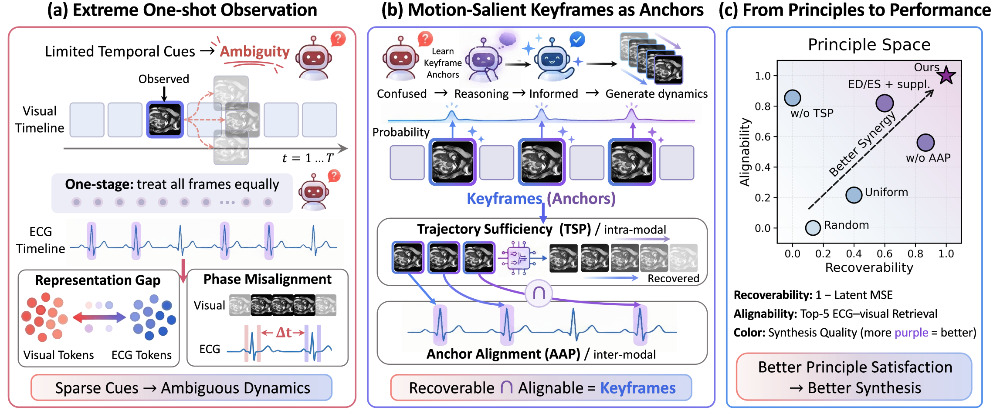
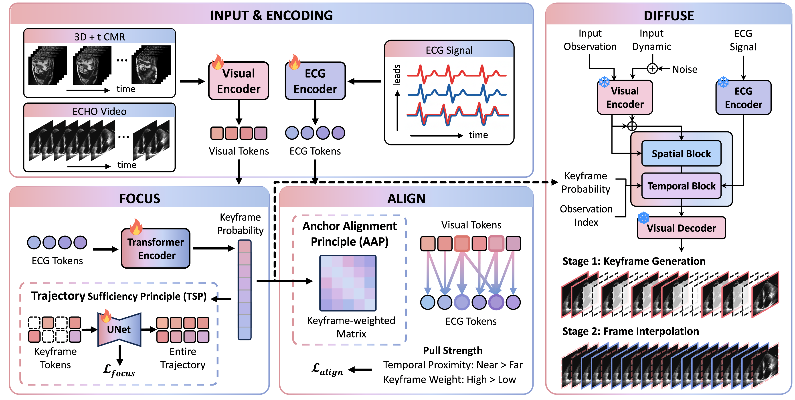

<div align="center">
  <h1>
    <picture>
      <source media="(prefers-color-scheme: dark)" srcset="assets/cardiofad-title-dark.svg">
      
    </picture>
  </h1>
  <h2>Focus, Align, and Diffuse:<br>Time-Series-Aware Keyframe Diffusion for Cardiac Dynamic Synthesis from Sparse Observations</h2>

  <p>
    <a href="https://arxiv.org/abs/2610.19050/">
    <a href="https://arxiv.org/pdf/2610.19050">
    <a href="https://cardiofad.github.io/"></a>
  </p>

  <p>
    <a href="https://scholar.google.com/citations?user=w6XeRtAAAAAJ">Junkai Liu</a><sup>1</sup>,
    <a href="https://scholar.google.com/citations?user=FMQxkjQAAAAJ">Haofan Wu</a><sup>1</sup>,
    <a href="https://scholar.google.com/citations?user=K-_DAdgAAAAJ">Nay Aung</a><sup>2</sup>,
    <a href="https://profiles.hopkinsmedicine.org/provider/joao-lima/2706109">Joao A. C. Lima</a><sup>3</sup>,
    <a href="https://scholar.google.com/citations?user=0_C_hmYAAAAJ">Steffen E. Petersen</a><sup>2</sup>,
    <a href="https://scholar.google.com/citations?hl=en&amp;user=gpbEdHEAAAAJ">Le Zhang</a><sup>1</sup>
  </p>

  <p>
    <sup>1</sup>University of Birmingham &nbsp;
    <sup>2</sup>Queen Mary University of London &nbsp;
    <sup>3</sup>Johns Hopkins University
  </p>
</div>

**CardioFAD** is a time-series-aware keyframe diffusion framework for **cardiac dynamic synthesis from sparse observations**.

<p align="center">
  
</p>

## 📑 Table of Contents

- [🔎 Overview](#-overview)
- [💡 Key Ideas](#-key-ideas)
- [🎬 Video Comparisons](#-video-comparisons)
- [📊 Experimental Scope](#-experimental-scope)
- [💿 Data](#-data)
- [📁 Repository Layout](#-repository-layout)
- [🛠️ Usage](#️-usage)
- [📜 License](#-license)
- [🙏 Acknowledgements](#-acknowledgements)
- [📮 Contact](#-contact)
- [🔗 Citation](#-citation)

## 🔎 Overview

**CardioFAD** synthesizes complete cardiac dynamics from a single CMR volume, CMR slice, or ECHO frame. It learns motion-salient keyframe anchors for trajectory recovery and ECG–visual alignment, then uses two-stage diffusion to generate the full sequence. This design improves visual quality, temporal coherence, and cardiac functional consistency under extreme one-shot sparsity.

<p align="center">
  
</p>

## 💡 Key Ideas

The **Focus–Align–Diffuse** framework has three components:

<table>
  <thead>
    <tr>
      <th align="left" width="34%">Component</th>
      <th align="left">Description</th>
    </tr>
  </thead>
  <tbody>
    <tr>
      <td>🎯 <b>Focus</b></td>
      <td>Learns trajectory-sufficient keyframes without predefined ED/ES landmarks, guided by the Trajectory Sufficiency Principle.</td>
    </tr>
    <tr>
      <td>🔗 <b>Align</b></td>
      <td>Uses keyframe-weighted ECG–visual alignment to form reliable cross-modal anchors, guided by the Anchor Alignment Principle.</td>
    </tr>
    <tr>
      <td>🌊 <b>Diffuse</b></td>
      <td>Uses two-stage diffusion to generate keyframes first, then interpolate the remaining frames.</td>
    </tr>
  </tbody>
</table>

## 🎬 Video Comparisons

Left to right: **Ground truth** and **CardioFAD**. These examples use the videos from our [project page](https://cardiofad.github.io/#videos), where more examples and interactive controls are available.

### CMR · Volume2Seq

One-volume-conditioned cardiac dynamics, shown at the middle slice (7 / 13).

https://github.com/user-attachments/assets/4df3b876-0886-46b2-a687-57a05b64bc57

### Echo · Frame2Video

One-frame-conditioned echocardiography video from EchoNet-Dynamic.

https://github.com/user-attachments/assets/a75253d5-d184-4490-bd6d-26895f90719b

## 📊 Experimental Scope

CardioFAD is evaluated on both **3D+t CMR** and **2D+t ECHO** synthesis tasks.

**3D+t CMR synthesis**

- Volume2Seq
- Slice2Seq

**2D+t ECHO synthesis**

- Frame2Video on EchoNet-Dynamic
- Frame2Video on EchoNet-Pediatric A4C
- Frame2Video on EchoNet-Pediatric PSAX

Evaluation covers visual quality and temporal coherence (PSNR, SSIM, LPIPS, FID, and FVD), alongside **cardiac functional consistency** assessed through ejection fraction (EF) estimation.

## 💿 Data

The two echocardiography datasets used in our experiments are available from their official download pages:

| Dataset | Views used in CardioFAD | Download |
| --- | --- | --- |
| EchoNet-Dynamic | Apical four-chamber (A4C) | [Download](https://stanford.redivis.com/datasets/66s1-2hsmzj5rn) |
| EchoNet-Pediatric | A4C and parasternal short-axis (PSAX) | [Download](https://stanfordaimi.azurewebsites.net/datasets/a84b6be6-0d33-41f9-8996-86e5df53b005) |

## 📁 Repository Layout

```text
CardioFAD/
├── tokenizer/
│   ├── CMR/          # CMR tokenizer training
│   └── Echo/         # Echo preprocessing and tokenizer training
├── generation/
│   ├── CMR/          # Latent extraction, Slice2Temp, and Volume2Temp
│   └── Echo/         # Latent extraction and Frame2Video
├── assets/           # README figures and video comparisons
├── requirements.txt
├── LICENSE           # Apache-2.0
└── README.md
```

## 🛠️ Usage

Use each script's `--help` to view its required arguments.

### CMR

| Step | Script |
| --- | --- |
| Train the tokenizer | [train_tokenizer_CMR.py](tokenizer/CMR/train_tokenizer_CMR.py) |
| Extract latents | [get_latent.py](generation/CMR/get_latent.py) |
| Train Slice2Temp | [train_slice2temp.py](generation/CMR/train_slice2temp.py) |
| Sample Slice2Temp | [sample_slice2temp.py](generation/CMR/sample_slice2temp.py) |
| Train Volume2Temp | [train_volume2temp.py](generation/CMR/train_volume2temp.py) |
| Sample Volume2Temp | [sample_volume2temp.py](generation/CMR/sample_volume2temp.py) |

### Echo

| Step | Script |
| --- | --- |
| Generate pseudo ECG | [generate_pseudoECG.py](tokenizer/Echo/generate_pseudoECG.py) |
| Preprocess videos | [preprocess_echo.py](tokenizer/Echo/preprocess_echo.py) |
| Train the tokenizer | [train_tokenizer_ECHO.py](tokenizer/Echo/train_tokenizer_ECHO.py) |
| Extract latents | [get_latent.py](generation/Echo/get_latent.py) |
| Train Frame2Video | [train_frame2video.py](generation/Echo/train_frame2video.py) |
| Sample Frame2Video | [sample_frame2video.py](generation/Echo/sample_frame2video.py) |

## 📜 License

This project is released under the [Apache-2.0 license](LICENSE).

Third-party components and datasets remain subject to their respective licenses and terms of use.

## 🙏 Acknowledgements

This repository builds on [MONAI](https://github.com/Project-MONAI/MONAI), [LeanVAE](https://github.com/westlake-repl/LeanVAE), [DiT](https://github.com/facebookresearch/DiT), [SiT](https://github.com/willisma/SiT), and [Latte](https://github.com/Vchitect/Latte). We thank the authors and contributors for sharing their code and research.

## 📮 Contact

For questions, please contact Junkai Liu at [jxl1920@student.bham.ac.uk](mailto:jxl1920@student.bham.ac.uk) or [liujk1997@gmail.com](mailto:liujk1997@gmail.com).

## 🔗 Citation

If our work helps your research, please consider giving us a star ⭐ or citing CardioFAD.

```bibtex
@misc{liu2026focusaligndiffusetimeseriesaware,
      title={Focus, Align, and Diffuse: Time-Series-Aware Keyframe Diffusion for Cardiac Dynamic Synthesis from Sparse Observations}, 
      author={Junkai Liu and Haofan Wu and Nay Aung and Joao A. C. Lima and Steffen E. Petersen and Le Zhang},
      year={2026},
      eprint={2610.19050},
      archivePrefix={arXiv},
      primaryClass={eess.IV},
      url={https://arxiv.org/abs/2610.19050}, 
}
```
